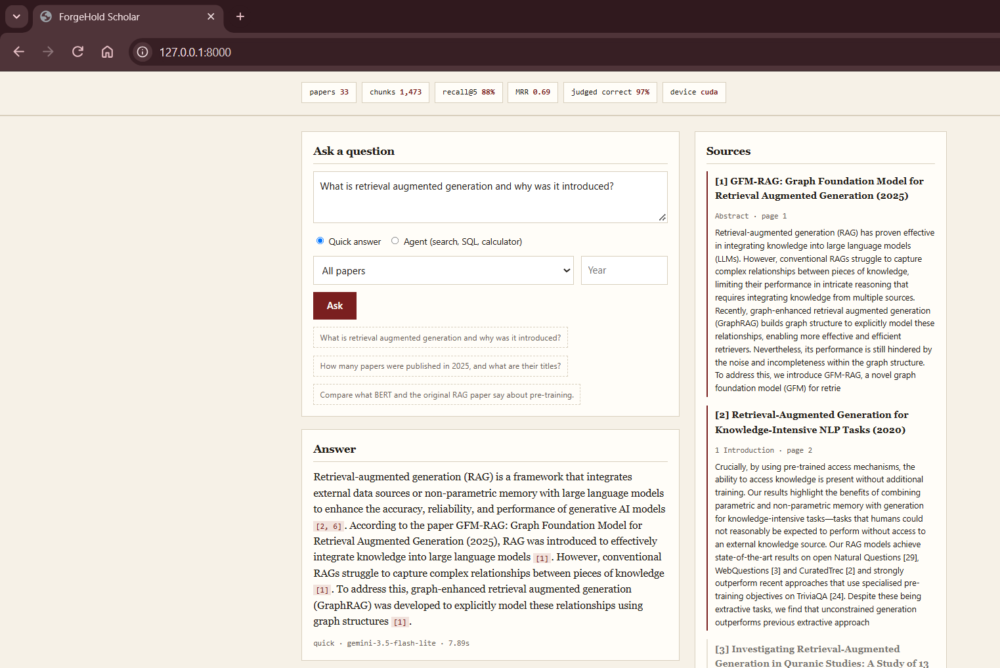

# ForgeHold Scholar

A retrieval-augmented question answering system over a private collection of research papers. It reads arXiv PDFs, repairs the text that PDF extraction damages, retrieves passages with hybrid search and reranking, and writes answers in which every claim carries a citation to a paper, section and page. An agent mode adds SQL over the paper catalog and a calculator.

Every design choice in this repository is backed by a measurement, and the measurements are reported with their limits.



## What it does

- **Ingestion.** Downloads papers through the arXiv API, extracts text with PyMuPDF and rebuilds sections and paragraphs from raw lines.
- **Text repair.** Rejoins words broken by line-end hyphenation, removes page numbers and publisher boilerplate, drops figure-only pages and validates section headings against the expected numbering sequence.
- **Chunking.** Four strategies were implemented and compared. The system uses structure-aware chunks that stay inside one section and carry the paper title and section heading.
- **Retrieval.** BM25 and dense embeddings (`BAAI/bge-small-en-v1.5`) fused with reciprocal rank fusion, then reranked by a cross-encoder (`cross-encoder/ms-marco-MiniLM-L-6-v2`). Results can be filtered by paper or year.
- **Answering.** Gemini through the API or a local model through Ollama, behind one interface. Answers must cite numbered passages and must refuse with `NOT_IN_CONTEXT` when the passages do not contain the answer.
- **Guardrails.** A reranker score floor stops off-topic questions before they reach the language model. Citations are checked against the passages that were actually supplied. Bibliography markers inside passages are rewritten so a model cannot mistake them for passage numbers.
- **Agent.** A hand-written tool loop with four tools: passage search, read-only SQL over a SQLite catalog, a calculator and finish. SQL is limited to single `SELECT` statements on a read-only connection, and the loop is capped at six steps.
- **Evaluation.** Retrieval metrics on a hand-written question set and on a generated corpus-level set, plus LLM-judged answer correctness and faithfulness.
- **Interface.** A FastAPI service and a single-page web interface that shows the answer, the cited sources and the agent trace.

## Architecture

```
arXiv API -> PDFs -> text extraction -> cleaning and structure -> chunks
                                                                    |
                                               embeddings + BM25 index
                                                                    |
question -> hybrid retrieval (RRF) -> cross-encoder rerank -> score floor
                                                                    |
                         language model -> cited answer -> citation check
```

## Results

All numbers below come from the reports in `output/`.

### Chunking strategy, one paper

35 hand-written questions over "Attention Is All You Need", hybrid retrieval without reranking.

| Strategy | Recall@5 | MRR |
|---|---|---|
| Fixed 1000 characters | 0.829 | 0.595 |
| One paragraph per chunk | 0.886 | 0.787 |
| One section per chunk | 0.971 | 0.836 |
| Structure-aware (used) | 0.971 | 0.853 |

Fixed-size chunking is clearly worse. Section and structure-aware chunking are close; structure-aware was chosen because its chunks are small enough to pass to a language model and give page-level citations.

### Retrieval, 33 papers

64 generated questions over 1,473 chunks. A hit means the exact source chunk was returned.

| Configuration | Recall@1 | Recall@5 | Recall@10 | MRR | Correct paper at rank 1 |
|---|---|---|---|---|---|
| BM25 | 0.422 | 0.781 | 0.875 | 0.584 | 0.922 |
| Dense | 0.422 | 0.625 | 0.781 | 0.523 | 0.938 |
| Hybrid | 0.438 | 0.812 | 0.891 | 0.601 | 0.922 |
| Hybrid + rerank | 0.531 | 0.875 | 0.938 | 0.690 | 0.984 |

Reranking did not help on the single paper but added 0.09 MRR on the full corpus, at a cost of about 0.45 seconds per query.

### Answers, 33 papers

The same 64 questions, answered by `gemini-3.5-flash-lite` and graded by an LLM judge.

| Measure | Result |
|---|---|
| Answered | 60 of 64 |
| Refused although the source passage was retrieved | 2 of 64 |
| Judged correct against the reference answer | 58 of 60 |
| Judged faithful to the passages | 60 of 60 |
| Answers with an invalid citation | 0 of 60 |
| Answers with every sentence cited | 49 of 60 |
| Mean generation time | 2.8 s |

## Limits of these results

- The corpus-level questions were generated by a language model from the chunks themselves, so they share vocabulary with their source. This favours BM25 and makes the retrieval numbers optimistic compared with real user questions.
- The answer judge is the same model that wrote the answers. The correctness and faithfulness figures are an upper estimate and have not been checked by a human.
- 64 questions is a small set. One question is 1.6 percentage points, so small differences between configurations are noise.
- The reference parser only handles numbered bibliographies. 18 of the 33 papers have no parsed references.
- Tables and equations are extracted as flat text and are not reconstructed.
- The cleaning heuristics were developed on a single-column paper. Layouts were not handled separately.
- The index is an in-memory NumPy matrix, which is adequate for 1,473 chunks and not for a large corpus.
- The local 3B model follows the citation rules less reliably than the API model.

## Quick start

Requirements: Python 3.12 and, for GPU inference, an NVIDIA card with a CUDA build of PyTorch.

```
python -m venv venv
venv\Scripts\activate
pip install torch --index-url https://download.pytorch.org/whl/cu124
pip install -r requirements.txt
```

Create a `.env` file with a Gemini API key:

```
GEMINI_API_KEY=your_key_here
```

Build the corpus and start the application:

```
python fetch_papers.py
python ingest.py
python build_index.py
python app.py
```

Then open `http://127.0.0.1:8000`.

Command line use:

```
python corpus_search.py "how do dense retrievers scale with model size"
python corpus_answer.py --paper BERT "what is next sentence prediction"
python agent.py "Which paper has the most pages, and what problem does it address?"
```

To use a local model instead of the API, install Ollama, run `ollama pull qwen2.5:3b-instruct` and add `--ollama` to `corpus_answer.py` or `agent.py`.

Reproduce the evaluation:

```
python make_eval_set.py
python corpus_evaluate.py
python eval_answers.py --limit 64
```

## Project structure

| File | Purpose |
|---|---|
| `fetch_papers.py` | Download papers and metadata from arXiv |
| `ingest.py` | Extract, clean and structure every paper |
| `build_index.py` | Chunk the corpus and compute embeddings |
| `corpus_search.py` | Hybrid search with reranking and filters |
| `corpus_answer.py` | Cited answers with refusal and citation checks |
| `agent.py` | Tool-using agent with search, SQL and calculator |
| `app.py`, `web/index.html` | FastAPI service and web interface |
| `make_eval_set.py` | Generate the corpus-level question set |
| `corpus_evaluate.py` | Retrieval metrics on the corpus |
| `eval_answers.py` | LLM-judged answer evaluation |
| `extract_text.py`, `clean_text.py`, `chunk_text.py`, `embed_chunks.py`, `search.py`, `rerank_search.py`, `answer.py`, `eval_dataset.py`, `evaluate.py` | Single-paper study used to develop the cleaning rules and compare chunking strategies. These expect arXiv 1706.03762 saved as `data/attention.pdf`. |

## Problems found and fixed during development

- Numbers from results tables such as 39.2 were read as section headings. Headings are now accepted only if they continue the section numbering; 33 false headings were rejected on the first paper.
- Removing every line-end hyphen destroyed real compounds such as "sequence-aligned". The cleaner now checks the document's own vocabulary before joining.
- A per-paper diversity cap pushed irrelevant passages above relevant ones. The cap now applies only to passages within a score margin of the best result.
- A small local model copied bibliography markers from passages as if they were citations. Markers are now rewritten before the prompt is built.

## Roadmap

- Human-written corpus-level questions and a different judge model
- Author-year reference parsing and a citation graph
- Table extraction
- A vector database in place of the in-memory index
- Container image and continuous integration

## Author

Usman Ahmad, ForgeHold Technologies

- Email: uahmad1666@gmail.com
- GitHub: https://github.com/ForgeHoldTech
- Portfolio: https://forgeholdtech.github.io